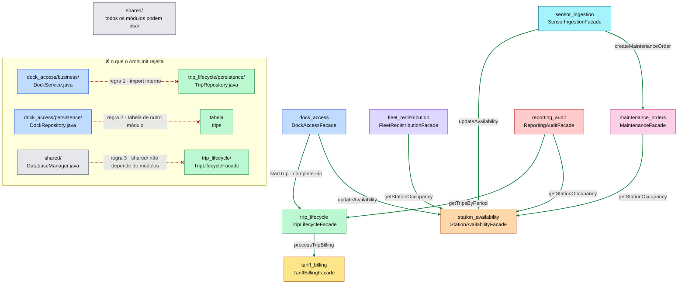
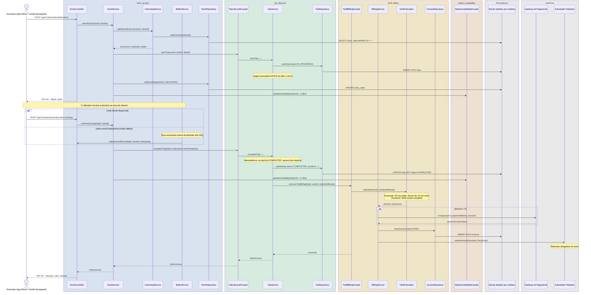
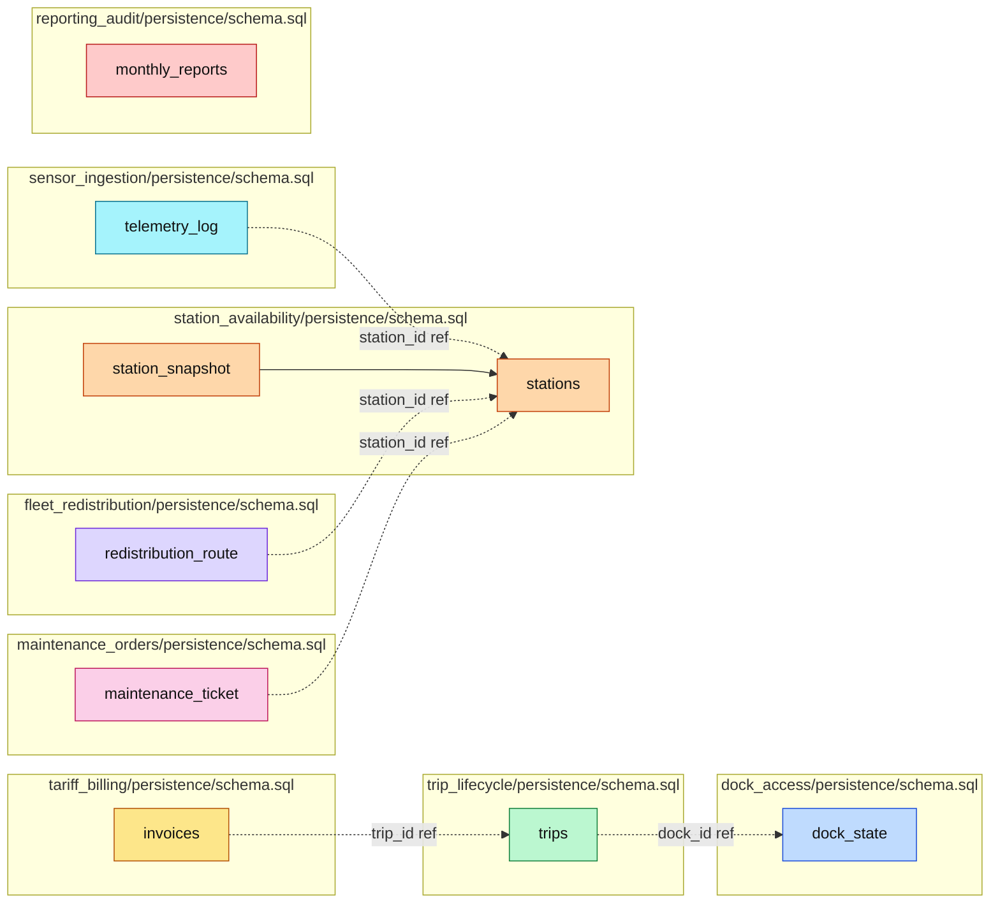

# Lisboa Pedala · Monólito Modular · Arquitetura

Sistema de gestão de bicicletas partilhadas para a cidade de Lisboa.
**Stack:** Java 21 · SQLite · Maven · JUnit 5 · ArchUnit

**Cor = módulo de domínio**, usada de forma consistente em todos os diagramas:

| Cor | Módulo |
|---|---|
| 🟦 azul | `dock_access` |
| 🟩 verde | `trip_lifecycle` |
| 🟨 amarelo | `tariff_billing` |
| 🟧 laranja | `station_availability` |
| 🩵 ciano | `sensor_ingestion` |
| 🟪 roxo | `fleet_redistribution` |
| 🩷 rosa | `maintenance_orders` |
| 🟥 vermelho | `reporting_audit` |
| 🤍 cinzento | técnico / partilhado |

---

## 1 · Particionamento de Topo

O primeiro corte é **por domínio** (*Modular Monolith*): as pastas de topo correspondem a módulos funcionais, um por componente lógico identificado em `02-componentes.md`. As camadas técnicas (apresentação, negócio, persistência) existem **dentro** de cada módulo.

```mermaid
flowchart TB
  app["Main.java · raiz de composição<br/>cria os módulos e injeta as fachadas<br/>Servidor HTTP embarcado (ex: Javalin)"]:::tech

  subgraph M["modules/"]
    direction LR
    subgraph da["dock_access/"]
      direction TB
      da0["DockAccessFacade.java · API pública<br/>unlockDock · confirmDocking · getDockStatus"]:::da
      da1["presentation/<br/>DockController.java"]:::da
      da2["business/<br/>DockService · UnlockingService<br/>DockingService · BufferService"]:::da
      da3["persistence/<br/>DockRepository.java<br/>schema.sql (1 tabela)"]:::da
    end
    subgraph tl["trip_lifecycle/"]
      direction TB
      tl0["TripLifecycleFacade.java · API pública<br/>startTrip · completeTrip · getActiveTrip<br/>getTripHistory · getTripsByPeriod"]:::tl
      tl1["presentation/<br/>TripController.java"]:::tl
      tl2["business/<br/>TripService · Trip · TripStatus"]:::tl
      tl3["persistence/<br/>TripRepository.java<br/>schema.sql (1 tabela)"]:::tl
    end
    subgraph tb["tariff_billing/"]
      direction TB
      tb0["TariffBillingFacade.java · API pública<br/>processTripBilling · getInvoiceByTripId<br/>getUserInvoices"]:::tb
      tb1["presentation/<br/>BillingController.java"]:::tb
      tb2["business/<br/>TariffCalculator · BillingService · Invoice<br/>adapters/ (PaymentGatewayAdapter · TaxAuthorityAdapter)"]:::tb
      tb3["persistence/<br/>InvoiceRepository.java<br/>schema.sql (1 tabela)"]:::tb
    end
    subgraph sa["station_availability/"]
      direction TB
      sa0["StationAvailabilityFacade.java · API pública<br/>getStationOccupancy · updateAvailability"]:::sa
      sa1["presentation/<br/>StationController.java"]:::sa
      sa2["business/<br/>AvailabilityService · StationService"]:::sa
      sa3["persistence/<br/>StationRepository.java<br/>schema.sql (1 tabela)"]:::sa
    end
    subgraph si["sensor_ingestion/"]
      direction TB
      si0["SensorIngestionFacade.java · API pública<br/>getLatestTelemetry"]:::si
      si1["presentation/<br/>TelemetryController.java"]:::si
      si2["business/<br/>TelemetryParserService · LostBikeDetectorService<br/>MalfunctionService · MalfunctionEmitter<br/>SignalDispatcherService"]:::si
      si3["persistence/<br/>TelemetryLogRepository.java<br/>schema.sql (1 tabela)"]:::si
    end
    subgraph fr["fleet_redistribution/"]
      direction TB
      fr0["FleetRedistributionFacade.java · API pública<br/>getActiveRoutes"]:::fr
      fr1["presentation/<br/>RouteController.java"]:::fr
      fr2["business/<br/>CalculateRoutes · RoutingClientService"]:::fr
      fr3["persistence/<br/>RedistributionRepository.java<br/>schema.sql (1 tabela)"]:::fr
    end
    subgraph mo["maintenance_orders/"]
      direction TB
      mo0["MaintenanceFacade.java · API pública<br/>createMaintenanceOrder · getPendingOrders"]:::mo
      mo1["presentation/<br/>MaintenanceController.java"]:::mo
      mo2["business/<br/>TicketService · TechnicianAssignmentService"]:::mo
      mo3["persistence/<br/>MaintenanceRepository.java<br/>schema.sql (1 tabela)"]:::mo
    end
    subgraph ra["reporting_audit/"]
      direction TB
      ra0["ReportingAuditFacade.java · API pública<br/>generateMonthlyReport · getStationOpenData"]:::ra
      ra1["presentation/<br/>ReportController.java"]:::ra
      ra2["business/<br/>ReportGeneratorService · CarbonSavingsCalculator<br/>ParishUsageAggregator · MunicipalReport"]:::ra
      ra3["persistence/<br/>ReportRepository.java<br/>schema.sql (1 tabela)"]:::ra
    end
  end

  shared["shared/ · DatabaseManager.java · HttpUtils.java<br/>AppErrors.java · IdempotencyRegistry.java<br/>código técnico comum; não depende de nenhum módulo"]:::tech

  app --> M
  M --> shared

  da0 ~~~ da1 ~~~ da2 ~~~ da3
  tl0 ~~~ tl1 ~~~ tl2 ~~~ tl3
  tb0 ~~~ tb1 ~~~ tb2 ~~~ tb3
  sa0 ~~~ sa1 ~~~ sa2 ~~~ sa3
  si0 ~~~ si1 ~~~ si2 ~~~ si3
  fr0 ~~~ fr1 ~~~ fr2 ~~~ fr3
  mo0 ~~~ mo1 ~~~ mo2 ~~~ mo3
  ra0 ~~~ ra1 ~~~ ra2 ~~~ ra3

  classDef da fill:#BFDBFE,stroke:#1D4ED8,color:#111
  classDef tl fill:#BBF7D0,stroke:#15803D,color:#111
  classDef tb fill:#FDE68A,stroke:#B45309,color:#111
  classDef sa fill:#FED7AA,stroke:#C2410C,color:#111
  classDef si fill:#A5F3FC,stroke:#0E7490,color:#111
  classDef fr fill:#DDD6FE,stroke:#6D28D9,color:#111
  classDef mo fill:#FBCFE8,stroke:#BE185D,color:#111
  classDef ra fill:#FECACA,stroke:#B91C1C,color:#111
  classDef tech fill:#E5E7EB,stroke:#4B5563,color:#111
```



> **Porquê domínio e não camadas?** Uma alteração às regras de tarifação toca apenas `tariff_billing/`; numa arquitetura layered, os mesmos ficheiros estariam espalhados por `presentation/`, `business/` e `persistence/`. A localidade da mudança é a principal vantagem do monólito modular para uma equipa de 6 pessoas com orçamento fixo.

---

## 2 · Regras de Dependência (Allowed-to-Use)

Um módulo só usa outro **através da sua Fachada pública**. As fachadas chegam por injeção de dependências em `Main.java`. Nenhum módulo acede diretamente à camada de persistência de outro.



As três regras verificadas automaticamente por **ArchUnit** (em `tests/architecture/`):

1. **Fachada obrigatória:** Um módulo só usa outro através da sua classe `*Facade.java`. É proibido qualquer import que atravesse a fronteira do módulo para uma classe interna (`business/`, `persistence/`).
2. **Isolamento de dados:** Nenhum módulo acede ao `*Repository.java` de outro módulo nem às suas tabelas SQLite. Cada módulo é dono exclusivo do seu `schema.sql`.
3. **`shared/` sem dependências de módulos:** O código técnico partilhado não pode importar nenhuma classe dos módulos de domínio.

---

## 3 · Sequência: Desbloquear → Devolver → Cobrar (US-1)

`POST /api/v1/docks/{dockId}/unlock` despoleta o fluxo principal. Os outros módulos são caixas-pretas vistas de fora; de fora só se vê a API pública (Fachada).



> **Robustez offline (Requisito de Robustez):** A doca retém eventos localmente até 24 h. Na reconexão, o `BufferService` reenvia e o `TripService` aplica idempotência — a viagem concluída não é duplicada e não gera nova cobrança (US-3).

---

## 4 · Dados

Cada módulo tem o seu próprio `schema.sql` com prefixo de tabela. Chaves estrangeiras existem **apenas dentro do mesmo módulo**. Referências a dados de outros módulos guardam apenas o `id` — sem FK; a integridade é responsabilidade do código.



> **Custo desta separação:** O SQLite não valida que um `station_id` em `telemetry_log` existe em `stations`. Se uma estação for removida, registos de outros módulos ficam com ids órfãos. Em troca, qualquer módulo pode evoluir o seu esquema sem quebrar FKs de outro módulo.

---

## 5 · Vista de Alocação

### 5.1. Componentes e ambientes de execução

| Componente | Ambiente | Tecnologia |
|---|---|---|
| `Main.java` (raiz de composição) | JVM — processo único | Java 21, Javalin (HTTP embarcado) |
| `dock_access` | Módulo in-process | Java 21 |
| `trip_lifecycle` | Módulo in-process | Java 21 |
| `tariff_billing` | Módulo in-process | Java 21 |
| `station_availability` | Módulo in-process | Java 21 |
| `sensor_ingestion` | Módulo in-process | Java 21 |
| `fleet_redistribution` | Módulo in-process | Java 21 |
| `maintenance_orders` | Módulo in-process | Java 21 |
| `reporting_audit` | Módulo in-process | Java 21 |
| Base de dados | Ficheiro local | SQLite 3 (JDBC via `sqlite-jdbc`) |
| Gateway de Pagamento | Sistema externo | HTTPS / REST (simulado) |
| Autoridade Tributária | Sistema externo | HTTPS / Webservice (simulado) |
| Doca física | Dispositivo IoT | MQTT / TCP (buffer local até 24 h) |

Todos os módulos correm **no mesmo processo JVM**. O SQLite acede ao mesmo ficheiro via JDBC; não há servidor de base de dados separado.

### 5.2. Estrutura de pastas do repositório

```text
lisboa_pedala/
├── src/main/java/pt/fcul/lisboapedala/
│   ├── Main.java                               ← raiz de composição
│   ├── shared/                                 ← código técnico comum
│   │   ├── DatabaseManager.java
│   │   ├── HttpUtils.java
│   │   ├── AppErrors.java
│   │   └── IdempotencyRegistry.java
│   ├── dock_access/
│   │   ├── DockAccessFacade.java               ← API pública
│   │   ├── presentation/DockController.java
│   │   ├── business/
│   │   │   ├── DockService.java
│   │   │   ├── UnlockingService.java
│   │   │   ├── DockingService.java
│   │   │   └── BufferService.java
│   │   └── persistence/DockRepository.java
│   ├── trip_lifecycle/
│   │   ├── TripLifecycleFacade.java
│   │   ├── presentation/TripController.java
│   │   ├── business/
│   │   │   ├── TripService.java
│   │   │   ├── Trip.java
│   │   │   └── TripStatus.java
│   │   └── persistence/TripRepository.java
│   ├── tariff_billing/
│   │   ├── TariffBillingFacade.java
│   │   ├── presentation/BillingController.java
│   │   ├── business/
│   │   │   ├── TariffCalculator.java
│   │   │   ├── BillingService.java
│   │   │   ├── Invoice.java
│   │   │   └── adapters/
│   │   │       ├── PaymentGatewayAdapter.java
│   │   │       └── TaxAuthorityAdapter.java
│   │   └── persistence/InvoiceRepository.java
│   ├── station_availability/
│   │   ├── StationAvailabilityFacade.java
│   │   ├── presentation/StationController.java
│   │   ├── business/
│   │   │   ├── AvailabilityService.java
│   │   │   └── StationService.java
│   │   └── persistence/StationRepository.java
│   ├── sensor_ingestion/
│   │   ├── SensorIngestionFacade.java
│   │   ├── presentation/TelemetryController.java
│   │   ├── business/
│   │   │   ├── TelemetryParserService.java
│   │   │   ├── LostBikeDetectorService.java
│   │   │   ├── MalfunctionService.java
│   │   │   ├── MalfunctionEmitter.java
│   │   │   └── SignalDispatcherService.java
│   │   └── persistence/TelemetryLogRepository.java
│   ├── fleet_redistribution/
│   │   ├── FleetRedistributionFacade.java
│   │   ├── presentation/RouteController.java
│   │   ├── business/
│   │   │   ├── CalculateRoutes.java
│   │   │   └── RoutingClientService.java
│   │   └── persistence/RedistributionRepository.java
│   ├── maintenance_orders/
│   │   ├── MaintenanceFacade.java
│   │   ├── presentation/MaintenanceController.java
│   │   ├── business/
│   │   │   ├── TicketService.java
│   │   │   └── TechnicianAssignmentService.java
│   │   └── persistence/MaintenanceRepository.java
│   └── reporting_audit/
│       ├── ReportingAuditFacade.java
│       ├── presentation/ReportController.java
│       ├── business/
│       │   ├── ReportGeneratorService.java
│       │   ├── CarbonSavingsCalculator.java
│       │   ├── ParishUsageAggregator.java
│       │   └── MunicipalReport.java
│       └── persistence/ReportRepository.java
├── src/main/resources/db/
│   ├── dock_access/schema.sql
│   ├── trip_lifecycle/schema.sql
│   ├── tariff_billing/schema.sql
│   ├── station_availability/schema.sql
│   ├── sensor_ingestion/schema.sql
│   ├── fleet_redistribution/schema.sql
│   ├── maintenance_orders/schema.sql
│   └── reporting_audit/schema.sql
├── src/test/java/pt/fcul/lisboapedala/architecture/
│   ├── ModuleBoundaryTest.java             ← regra 1: fachada obrigatória
│   ├── DataIsolationTest.java              ← regra 2: isolamento de dados
│   └── SharedIndependenceTest.java         ← regra 3: shared/ sem deps. de módulos
├── pom.xml
└── ARCHITECTURE.md
```

### 5.3. Responsabilidade da equipa

| Módulo | Responsável principal | Responsabilidades |
|---|---|---|
| `dock_access` | A definir | Desbloqueio, devolução e comunicação com as docas |
| `trip_lifecycle` | A definir | Registo, acompanhamento e conclusão das viagens |
| `tariff_billing` | A definir | Cálculo de tarifas, pagamentos e faturação |
| `station_availability` | A definir | Disponibilidade de bicicletas e docas nas estações |
| `sensor_ingestion` | A definir | Receção e processamento da telemetria |
| `fleet_redistribution` | A definir | Redistribuição da frota e gestão de rotas |
| `maintenance_orders` | A definir | Registo e acompanhamento das ordens de manutenção |
| `reporting_audit` | A definir | Relatórios operacionais, agregação de dados e auditoria |
| `shared/` + infraestrutura | A definir | DatabaseManager, HTTP utils, testes arquiteturais |

Exemplo de `.github/CODEOWNERS` (adaptar aos usernames reais):

```text
# Módulos de domínio
/src/main/java/pt/fcul/lisboapedala/dock_access/          @utilizador_a
/src/main/java/pt/fcul/lisboapedala/trip_lifecycle/       @utilizador_b
/src/main/java/pt/fcul/lisboapedala/tariff_billing/       @utilizador_c
/src/main/java/pt/fcul/lisboapedala/station_availability/ @utilizador_d
/src/main/java/pt/fcul/lisboapedala/sensor_ingestion/     @utilizador_e
/src/main/java/pt/fcul/lisboapedala/fleet_redistribution/ @utilizador_f
/src/main/java/pt/fcul/lisboapedala/maintenance_orders/   @utilizador_g
/src/main/java/pt/fcul/lisboapedala/reporting_audit/      @utilizador_h

# Testes e regras arquiteturais
/src/test/java/pt/fcul/lisboapedala/architecture/         @responsavel_arquitetura
/src/main/java/pt/fcul/lisboapedala/shared/               @responsavel_arquitetura
```
