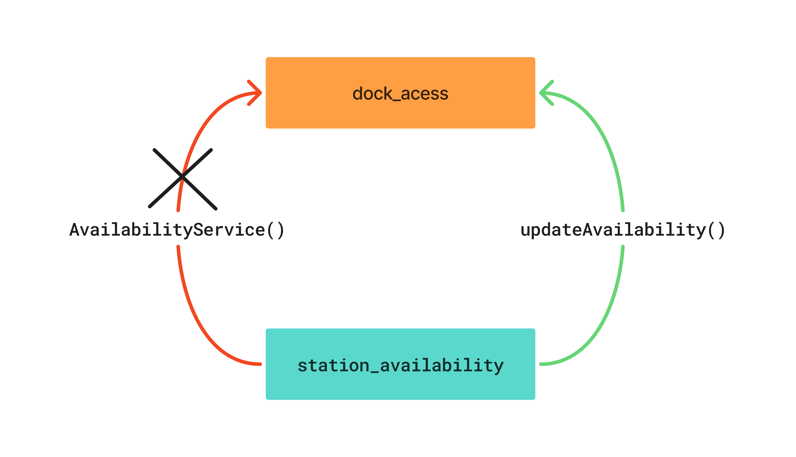

# 03 — Particionamento e Vistas Arquiteturais

## 1. Introdução

Este documento especifica a organização estrutural e as vistas arquiteturais do sistema **Lisboa Pedala**, tendo por base os componentes lógicos identificados em `02-componentes.md` e os requisitos do enunciado.

O objetivo é definir a organização do código-fonte em tempo de desenvolvimento, explicitar as dependências permitidas entre módulos e descrever a colaboração entre componentes durante a execução dos principais casos de utilização. Pretende-se reduzir o acoplamento, aumentar a coesão e facilitar a evolução e a verificação da arquitetura.

O documento apresenta os seguintes componentes:

1. **Particionamento de topo e trade-offs:** comparação entre uma organização técnica por camadas e uma organização por domínio, justificando a opção selecionada.
2. **Vista de módulos e regras `Allowed-to-Use`:** organização dos módulos de topo e definição das dependências permitidas e proibidas.
3. **Vista de Componentes e Conectores (C&C)** 
4. **Vista de Alocação:** distribuição dos componentes lógicos pelos elementos de execução previstos para o sistema.

---

## 2. Particionamento de Topo

O particionamento de topo define a primeira divisão do código-fonte em módulos e influencia a forma como as alterações futuras são distribuídas pela implementação.

Para o Lisboa Pedala, foram consideradas duas alternativas: o particionamento técnico, que organiza o código por camadas, e o particionamento por domínio, que organiza o código de acordo com as responsabilidades funcionais do sistema.

### 2.1. Comparação de alternativas: técnico vs. domínio

#### Alternativa A — Particionamento técnico (*Layered Architecture*)

Nesta abordagem, o código é organizado de acordo com a sua função técnica, por exemplo, apresentação, lógica de negócio e persistência.

```text
lisboa_pedala/
├── presentation/
│   ├── dock_access/
│   ├── trip_lifecycle/
│   ├── tariff_billing/
|   ├── station_availability/
|   ├── telemetry_ingestion/
│   ├── fleet_redistribution/ 
│   ├── maintenance_orders/ 
│   └── reporting_audit/
├── business/
│   ├── dock_access/
│   ├── trip_lifecycle/
│   ├── tariff_billing/
|   ├── station_availability/
|   ├── telemetry_ingestion/
│   ├── fleet_redistribution/ 
│   ├── maintenance_orders/ 
│   └── reporting_audit/
├── persistence/
│   ├── dock_access/
│   ├── trip_lifecycle/
│   ├── tariff_billing/
|   ├── station_availability/
|   ├── telemetry_ingestion/
│   ├── fleet_redistribution/ 
│   ├── maintenance_orders/ 
│   └── reporting_audit/
│   
└── database
```

**Vantagens:**

- Torna explícita a separação entre responsabilidades técnicas.
- Facilita a identificação de funcionalidades relacionadas com a interface, a lógica de negócio ou o acesso aos dados.
- Pode simplificar alterações tecnológicas transversais, desde que as dependências entre camadas estejam bem definidas.

**Desvantagens no Lisboa Pedala:**

- **Dispersão funcional:** uma alteração ao processo de faturação ou às regras de devolução pode obrigar a modificar ficheiros em várias camadas.
- **Menor localidade da mudança:** os elementos que implementam uma funcionalidade não ficam necessariamente próximos no código-fonte.
- **Risco de *Architecture Sinkhole*:** algumas chamadas podem atravessar várias camadas sem acrescentar lógica relevante, funcionando apenas como encaminhamento entre componentes.

Esta alternativa favorece a organização por responsabilidade técnica, mas pode tornar menos evidente a localização das regras de negócio. Para alem disto a divisão layered, convem ser evitada aquando o desenvolvimento de sistemas e aplicações grandes, como é o caso da Lisboa Pedala. 

#### Alternativa B — Particionamento por domínio (*Modular Monolith*)

Nesta abordagem, o primeiro nível de organização corresponde às responsabilidades funcionais do sistema. Cada módulo reúne os elementos necessários para implementar a sua área do domínio, mantendo contratos explícitos para a comunicação com outros módulos.

```text
lisboa_pedala/
├── dock_access/
├── trip_lifecycle/
├── tariff_billing/
├── station_availability/
├── sensor_ingestion/
├── fleet_redistribution/
├── maintenance_orders/
├── history_reader/
└── reporting_audit/
```

**Vantagens no Lisboa Pedala:**

- **Localidade da mudança:** alterações às regras de tarifação ficam concentradas em `tariff_billing`; alterações ao ciclo de vida das viagens ficam concentradas em `trip_lifecycle`.
- **Coesão funcional:** cada módulo agrupa responsabilidades relacionadas com uma capacidade do sistema.
- **Fronteiras explícitas:** as dependências entre módulos podem ser documentadas e verificadas automaticamente.
- **Evolução controlada:** uma eventual necessidade de separar um módulo para outro processo ou serviço poderá ser avaliada posteriormente, caso existam razões concretas para isso.

**Desvantagens:**

- Alterações transversais, como a migração do mecanismo de persistência, podem afetar vários módulos.
- Sem regras de dependência e encapsulamento, os módulos podem começar a aceder diretamente aos detalhes internos uns dos outros, degradando a modularidade.
- A divisão por domínio exige cuidado na definição da propriedade dos dados e das interfaces entre módulos.
-  Evitar quando existe um exigência elevada de escalabilidade, elasticidade, disponibilidade, tolerância a falhas ou desempenho


### 2.2. Avaliação dos trade-offs e seleção

No contexto deste trabalho optou-se pelo **particionamento por domínio, implementado como monólito modular**.

A principal razão para a escolha do monólito modular prende-se com a natureza das alterações funcionais previstas para o Lisboa Pedala. A gestão de viagens, a tarifação, a disponibilidade das estações e a manutenção representam responsabilidades distintas que beneficiam de módulos com fronteiras bem definidas. Desta forma, uma alteração às regras de tarifação tende a ficar concentrada em ``tariff_billing``, enquanto, numa arquitetura organizada por camadas técnicas, os elementos dessa funcionalidade podem encontrar-se distribuídos por várias camadas, reduzindo a localidade da mudança.

Esta vantagem implica, contudo, um maior cuidado na definição e aplicação das dependências entre módulos. Além disso, as alterações tecnológicas transversais, como a substituição da tecnologia de persistência, podem afetar vários módulos. Assim, o particionamento por domínio não é necessariamente a melhor opção para todos os tipos de alteração, devendo a escolha refletir as prioridades do sistema.

A manutenção de uma única unidade de implantação é também compatível com a dimensão da equipa e com o orçamento disponível, permitindo evitar, nesta fase, a complexidade operacional associada a uma arquitetura distribuída. Em contrapartida, os módulos não podem ser implantados nem escalados de forma independente, o que limita a capacidade de responder isoladamente a aumentos de carga numa área específica do sistema.

Embora os materiais fornecidos recomendem evitar o monólito modular quando existem exigências elevadas de elasticidade, esta característica deve ser ponderada à luz do contexto concreto do Lisboa Pedala. Ao contrário de plataformas como a Ticketmaster, que podem enfrentar picos muito elevados de procura durante a venda de bilhetes para eventos populares, o Lisboa Pedala tem uma dimensão operacional prevista de 1 500 bicicletas distribuídas por 180 estações. Mesmo considerando possíveis aumentos da procura durante eventos como os Santos Populares, não se considera, à partida, que estes picos justifiquem, por si só, a adoção de uma arquitetura distribuída. Esta avaliação constitui, no entanto, uma hipótese de projeto que deverá ser validada através de estimativas de carga e, posteriormente, de dados de utilização reais.

Deste modo, embora a elasticidade continue a ser uma característica relevante, a escala prevista do sistema não constitui, nesta fase, um motivo suficiente para rejeitar o monólito modular. A decisão deverá ser reavaliada caso a utilização real revele picos de carga, requisitos de disponibilidade ou necessidades de escalabilidade que a arquitetura adotada não consiga satisfazer de forma adequada.

Conclui-se, assim, que o monólito modular representa um compromisso adequado às necessidades atualmente conhecidas do Lisboa Pedala, privilegiando a coesão funcional e a localidade das alterações ao domínio, sem introduzir antecipadamente os custos operacionais de uma arquitetura distribuída. A concretização destas vantagens depende, contudo, da definição clara das fronteiras entre módulos, da aplicação de regras de encapsulamento e da utilização de testes arquiteturais que permitam detetar e prevenir a degradação da modularidade ao longo do desenvolvimento.

### 2.3. Topologia dos módulos de domínio

Com base nos componentes definidos em `02-componentes.md`, propõe-se a seguinte organização de topo:

```text
lisboa_pedala/
├── dock_access/
├── trip_lifecycle/
├── tariff_billing/
├── station_availability/
├── sensor_ingestion/
├── fleet_redistribution/
├── maintenance_orders/
├── history_reader/
└── reporting_audit/
```

As responsabilidades são as seguintes:

| Módulo | Responsabilidade |
|---|---|
| `dock_access` | Validar pedidos de desbloqueio e devolução e comunicar com as docas físicas. Inclui o tratamento dos eventos recebidos após períodos de desconexão. |
| `trip_lifecycle` | Gerir o início, a duração e o fecho das viagens, incluindo os dados necessários para consultar o histórico de viagens. |
| `tariff_billing` | Calcular tarifas, processar pagamentos, aplicar regras tarifárias e gerir a emissão e comunicação de faturas. |
| `station_availability` | Manter a representação atualizada da ocupação das estações e da disponibilidade de bicicletas e docas. |
| `sensor_ingestion` | Receber e processar telemetria proveniente das bicicletas e dos dispositivos associados. |
| `fleet_redistribution` | Calcular propostas de redistribuição de bicicletas e apoiar a consulta e execução das rotas das carrinhas. |
| `maintenance_orders` | Criar, acompanhar e concluir ordens de manutenção, incluindo as originadas por reportes de avarias ou anomalias detetadas. |
| `reporting_audit` | Agregar informação operacional para produzir relatórios e apoiar a auditoria. |
| `history_reader` | Agregar as informações de pagamentos e viagens do utilizador. |


### 2.4. Regras de Dependência

As dependências entre os módulos de domínio obedecem às seguintes regras restritivas (*Allowed-to-Use*):

| Módulo Origem | Módulos Permitidos (*Allowed-to-Use*) | Módulos Proibidos |
| :--- | :--- | :--- |
| `dock_access` | `trip_lifecycle`, `station_availability` | `tariff_billing`, `sensor_ingestion` |
| `trip_lifecycle` | `tariff_billing`, `station_availability` | `dock_access`, `sensor_ingestion` |
| `tariff_billing` | *(Nenhum módulo)* | Todos os outros |
| `station_availability` | `sensor_ingestion` | Todos os outros |
| `sensor_ingestion` | *(Nenhum)* | `trip_lifecycle`, `tariff_billing` |
| `fleet_redistribution` | `station_availability` | `trip_lifecycle`, `tariff_billing` |
| `maintenance_orders` | `sensor_ingestion` | Módulos de negócio crítico |
| `history_reader` |  `tariff_billing`,`trip_lifecycle`| Todos os outros
| `reporting_audit` | Todos os módulos de leitura (em modo de agregação) | Modificação direta de estado |

Estas regras serão transpostas para testes arquiteturais automáticos (*fitness functions* na pasta `tests/architecture/`) para impedir violações no código-fonte[cite: 7].


## 3. Vista de Módulos e Regras Allowed-to-Use

A vista de módulos descreve como o código é organizado e quais os módulos que podem utilizar os contratos de outros módulos.

A estrutura proposta é:

```text
dock_access/
├── DockAccessFacade.java · API pública     # Fachada que expõe apenas os contratos permitidos para os outros módulos
│   ├── unlockDock()                        # Destranca uma doca específica para levantamento de bicicleta
│   ├── confirmDocking()                    # Confirma o encaixe bem-sucedido de uma bicicleta numa doca
│   └── getDockStatus()                     # Consulta o estado atual de uma doca (livre/ocupada/avariada)
├── presentation/                           # Camada de Apresentação
│   └── DockController.java                 # Controlador REST que recebe os pedidos da App móvel nas estações
├── business/                               # Camada de Lógica de Negócio (Domínio)
│   ├── DockService.java                    # Gere o estado geral e ciclo de vida das docas
│   ├── UnlockingService.java               # Lógica específica de validação de tokens e destrancagem segura
│   ├── DockingService.java                 # Lógica de confirmação de encaixe e leitura de sensores da doca
│   └── BufferService.java                  # Gere o buffer temporário ou reentras de comunicação offline
└── persistence/                            # Camada de Persistência de Dados
    ├── DockEventRepository.java            # Comunica com a base de dados para registo duradouro de eventos de doca
    └── schema.sql                          # DDL da tabela privada 'dock_access_events'

station_availability/
├── StationAvailabilityFacade.java · API pública # Fachada que expõe apenas os contratos permitidos para os outros módulos
│   ├── getStationOccupancy()               # Devolve quantas docas livres (sem bicicleta) e ocupadas (com bicicleta) existem
│   └── updateAvailability()                # Atualiza o estado da estação quando uma doca muda de livre para ocupada (ou vice-versa)
├── presentation/                           # Camada de Apresentação
│   └── StationController.java              # Expõe os endpoints REST para o frontend consultar a ocupação do mapa em tempo real
├── business/                               # Camada de Lógica de Negócio (Domínio)
│   ├── AvailabilityService.java            # Calcula a ocupação atual: doca livre = sem bicicleta; doca ocupada = com bicicleta
│   └── StationService.java                 # Gere os dados de localização e capacidade máxima das 180 estações
└── persistence/                            # Camada de Persistência de Dados
    ├── StationRepository.java              # Comunica com a base de dados para ler e atualizar o estado das estações
    └── schema.sql (1 tabela)               # Tabela que guarda a identidade da estação, localização e contadores consolidados

sensor_ingestion/
├── SensorIngestionFacade.java · API pública      # Ponto de entrada para outros módulos consultarem dados em tempo real
│   └── getLatestTelemetry()
├── presentation/                                 # Camada de Apresentação / Ingestão de Rede
│   └── TelemetryController.java                  # Endpoint / Webhook para receber os pings das 1.050 bikes (~35 req/s)
├── business/                                     # Camada de Lógica de Negócio (Processamento e IA/Regras)
│   ├── TelemetryParserService.java               # Descodifica o pacote binário/JSON bruto (GPS, bateria, velocidade)
│   ├── LostBikeDetectorService.java              # Deteta falhas prolongadas de sinal (> 2h sem ping fora da doca)
│   ├── MalfunctionService.java                   # Avalia componentes e deteta avarias mecânicas/elétricas
│   ├── MalfunctionEmitter.java                   # Dispara o alerta para a fachada de manutenção de forma assíncrona
│   └── SignalDispatcherService.java              # Encaminha os dados limpos para os módulos interessados
└── persistence/                                  # Camada de Persistência de Dados
    └── TelemetryLogRepository.java               # Guarda histórico de telemetria e rastreio de percurso


trip_lifecycle/
├── TripLifecycleFacade.java · API pública  # Fachada pública do módulo
│   ├── startTrip()                      # Inicia uma nova viagem (chamado por dock_access)
│   ├── completeTrip()                   # Encerra a viagem e calcula duração (chamado por dock_access)
│   ├── getActiveTrip()                  # Consulta viagem em curso de um utilizador (para a app)
│   ├── getTripHistory()                 # Histórico de viagens do utilizador (para a app)
│   └── getTripsByPeriod()               # Consulta viagens num intervalo (para reporting_audit)
├── presentation/
│   └── TripController.java              # Endpoints REST (ex: GET /api/v1/trips/active, GET /api/v1/trips/history)
├── business/
│   ├── TripService.java                 # Coordena as regras: validações, cálculo de tempos, idempotência e aciona tariff_billing
│   ├── Trip.java                        # Entidade de domínio: id, userId, bikeId, estações, timestamps, duração, status
│   └── TripStatus.java                  # Enum com os estados: IN_PROGRESS, COMPLETED, CANCELLED
└── persistence/
    ├── TripRepository.java              # Queries SQL à tabela privada 'trips' (save, update, findById, findByUser)
    └── schema.sql                       # DDL da tabela 'trips' (propriedade exclusiva deste módulo)

tariff_billing/
├── TariffBillingFacade.java · API pública  # Fachada pública do módulo (único ponto de entrada para outros módulos)
│   ├── processTripBilling()             # Calcula valor, cobra e gera fatura (chamado por trip_lifecycle)
│   ├── getInvoiceByTripId()             # Consulta a fatura associada a uma viagem
│   └── getUserInvoices()                # Lista todas as faturas de um determinado utilizador
├── presentation/
│   └── BillingController.java           # Endpoints REST (ex: GET /api/v1/invoices/{id}, GET /api/v1/invoices/download)
├── business/
│   ├── TariffCalculator.java            # Aplica regras de preço (45 min grátis passe anual, blocos 15 min, além de utilizador normal)
│   ├── BillingService.java              # Orquestra cobrança, geração de fatura e comunicação com a AT
│   ├── Invoice.java                     # Entidade de domínio: id, tripId, userId, amount, tax, issuedAt, status
│   └── adapters/                        # Adaptadores para serviços externos
│       ├── PaymentGatewayAdapter.java   # Comunicação simulada com MB WAY e Cartão
│       └── TaxAuthorityAdapter.java     # Comunicação com o webservice da Autoridade Tributária (AT)
└── persistence/
    ├── InvoiceRepository.java           # Queries SQL para guardar e consultar faturas (retenção de 10 anos)
    └── schema.sql                       # DDL da tabela privada 'invoices'


reporting_audit/
├── ReportingAuditFacade.java · API pública # Fachada pública do módulo
│   ├── generateMonthlyReport()          # Gera e devolve o relatório mensal municipal consolidado
│   └── getStationOpenData()             # Prepara métricas agregadas de estações para dados abertos
├── presentation/
│   └── ReportController.java            # Endpoints REST exclusivos para Gestores Municipais (ex: GET /api/v1/admin/reports/monthly)
├── business/
│   ├── ReportGeneratorService.java      # Coordena a agregação: pede viagens a trip_lifecycle e estações a station_availability
│   ├── CarbonSavingsCalculator.java     # Aplica a fórmula do CO2 evitado face ao transporte motorizado
│   ├── ParishUsageAggregator.java       # Agrupa viagens por freguesia (origem/destino em Lisboa)
│   └── MunicipalReport.java             # Entidade/modelo do relatório mensal gerado
└── persistence/
    ├── ReportRepository.java            # Guarda o histórico dos relatórios mensais gerados para fins de auditoria
    └── schema.sql                       # DDL da tabela privada 'monthly_reports'

history_reader/
├── HistoryReaderFacade.java · API pública  # Fachada pública do módulo
│   ├── getUserCompleteHistory()         # Devolve a lista unificada de viagens com as respetivas faturas
│   └── getTripReceiptDetails()          # Devolve o detalhe de uma viagem específica com o recibo fiscal associado
├── presentation/
│   └── HistoryController.java           # Endpoints REST para a app móvel (ex: GET /api/v1/me/history, GET /api/v1/me/trips/{id}/receipt)
├── business/
│   ├── HistoryAggregationService.java   # Consulta trip_lifecycle e tariff_billing e faz o "merge" dos dados
│   └── UserTripHistoryDTO.java          # Objeto de transferência: dados da viagem (hora, estações) + fatura (valor, estado, link AT)
└── persistence/
    # Nota: Sem persistência própria nem schema.sql (conforme ADR-002 e ADR-006)

fleet_redistribution/
├── FleetRedistributionFacade.java · API pública
│   └── getActiveRoutes()      
├── presentation/
│   └── RouteReader.java           # Controlador REST / Ponto de entrada
├── business/
│   ├── CalculateRoutes.java             # Lógica central do algoritmo de otimização de frota
│   └── RoutingClientService.java       # Cena para comunicar com mapa ns se é preciso
└── persistence/
    ├── RedistributionRepository.java # Acesso à base de dados
    └── schema.sql                    # DDL da tabela privada 'fleet_redistribution_routes'

maintenance_orders/
├── MaintenanceOrdersFacade.java · API pública # Fachada que expõe os contratos permitidos para os outros módulos
│   ├── createMaintenanceOrder()            # Permite reportar uma avaria (numa doca ou bicicleta) e abrir ordem de reparação
│   └── getPendingOrders()                  # Devolve a lista de manutenções pendentes para a equipa técnica
├── presentation/                           # Camada de Apresentação
│   └── MaintenanceController.java          # Controlador REST para a app/painel dos técnicos de manutenção em campo
├── business/                               # Camada de Lógica de Negócio (Domínio)
│   ├── TicketService.java                  # Gere o ciclo de vida da avaria (aberta, em progresso, resolvida)
│   └── TechnicianAssignmentService.java    # Lógica de atribuição de ordens de serviço aos técnicos disponíveis
└── persistence/                            # Camada de Persistência de Dados
    ├── MaintenanceOrderRepository.java     # Comunica com a base de dados para gravar o registo de avarias
    └── schema.sql (1 tabela)               # Tabela que guarda os detalhes das ordens de manutenção, estado e histórico
```
### Regras Allowed-to-Use

Para garantir que o monólito modular mantém a coesão interna e um baixo acoplamento entre os diferentes domínios do sistema **Lisboa Pedala**, são aplicadas estritamente duas regras fundamentais de arquitetura:

1. **Utilização exclusiva via API Pública (Fachada):** 
   Um módulo só pode interagir com outro através da respetiva API pública (*Fachada*). Por exemplo, o módulo `dock_access` tem permissão para aceder ao método `updateAvailability()` exposto na API pública de `station_availability` para atualizar o estado das docas livres e ocupadas. No entanto, é estritamente proibido o acesso direto a componentes internos da camada de negócio, como o `AvailabilityService()`. 

    

2. **Isolamento Estrito de Dados:** 
   Nenhum módulo tem acesso direto à base de dados ou aos repositórios de outro módulo. Cada subdomínio é dono exclusivo do seu esquema de dados (definido no seu próprio `schema.sql`), garantindo que toda a persistência é encapsulada e gerida internamente.


## 4. Vista de Componentes e Conectores (C&C) — Fluxo Desbloquear → Devolver → Cobrar

A vista de Componentes e Conectores (C&C) descreve a arquitetura em tempo de execução (*runtime*), focando-se nas entidades computacionais ativas e nos mecanismos/canais de comunicação utilizados para concretizar o fluxo transacional central do sistema Lisboa Pedala (**US-1**: *como assinante, desbloqueio e devolvo uma bicicleta e a viagem fica registada e cobrada*).

### 4.1. Componentes em Tempo de Execução (*Runtime Components*)

| Componente | Tipo de Elemento | Responsabilidade no Fluxo |
| :--- | :--- | :--- |
| **`App Móvel / Totem`** | Cliente de Utilizador | Ponto de interação do ciclista (leitura do código QR na doca ou passagem do cartão Navegante). |
| **`Doca Física (Dock Controller)`** | Dispositivo IoT Embarcado | Hardware na estação que comanda o trinco eletromecânico, deteta sensores de presença de bicicleta e possui buffer local de eventos (até 24h de eventos em modo *offline*). |
| **`dock_access`** | Serviço Backend (Monólito) | Valida permissões de desbloqueio, envia comandos físicos à doca e recebe confirmações de trancamento/devolução. |
| **`trip_lifecycle`** | Serviço Backend (Monólito) | Gere o ciclo de vida transacional da viagem (registo inicial, transição para `EM_CURSO`, encerramento, cálculo de duração e garantia de idempotência). |
| **`station_availability`** | Serviço Backend (Monólito) | Atualiza em tempo real os contadores de docas livres e bicicletas disponíveis na estação. |
| **`tariff_billing`** | Serviço Backend (Monólito) | Aplica as regras de tarifação (45 min grátis para assinantes, blocos de 15 min extra, tarifários avulsos para ocasionais) e coordena a cobrança e faturação. |
| **`Base de Dados Relacional`** | Sistema de Persistência | Armazena o estado das viagens e faturas com garantias ACID e retenção histórica exigida por lei (10 anos para dados fiscais). |
| **`Gateway de Pagamentos`** | Sistema Externo | Serviço externo de processamento financeiro (MB WAY ou Cartão de Crédito). |
| **`Autoridade Tributária (AT)`** | Sistema Externo | Webservice da AT para validação e comunicação eletrónica de faturas. |

### 4.2. Conectores e Protocolos de Comunicação (*Connectors*)

Em conformidade com a notação C&C (Bass, Clements & Kazman), cada canal de comunicação entre componentes possui propriedades e garantias específicas:

| Conector | Tipo de Conector | Protocolo / Mecanismo | Sincronismo | Garantias e Tratamento de Falhas |
| :--- | :--- | :--- | :---: | :--- |
| **C1: Cliente $\rightarrow$ `dock_access`** | Chamada Remota | HTTPS / REST (JSON) | Síncrono | Autenticação por token/QR code; timeout e resposta com confirmação imediata. |
| **C2: Doca Física $\leftrightarrow$ `dock_access`** | Mensagens IoT / RPC | Rede Móvel (MQTT / TCP) | Assíncrono com tolerância a falhas | **Tolerância a desconexão:** se a rede falhar, a doca armazena o evento em memória local (até 24h). Na reconexão, o reenvio é processado com idempotência no backend. |
| **C3: Inter-Módulos (`dock_access` $\rightarrow$ `trip_lifecycle` $\rightarrow$ `tariff_billing`)** | Chamada de Procedimento | *In-Process Method Call* (Java/Python) | Síncrono | Chamadas locais em memória via API pública (fachada), de alta velocidade e sem overhead de rede. |
| **C4: Módulos $\rightarrow$ Base de Dados** | Acesso a Dados | Driver SQL / JDBC | Síncrono transacional | Transações atómicas para assegurar que viagens e faturas mantêm integridade referencial sem duplicações. |
| **C5: `tariff_billing` $\rightarrow$ Gateways Externos** | Chamada Remota Web | HTTPS / REST | Síncrono com retries | Circuit breaker e timeouts dedicados; gravação do estado `PENDENTE` em caso de falha de comunicação externa. |

### 4.3. Diagrama de Sequência C&C do Fluxo

O diagrama seguinte ilustra as interações entre os componentes e os respetivos conectores ao longo das três fases do fluxo:


### 4.4. Descrição Detalhada das Fases do Fluxo

1. **Fase de Desbloqueio (`desbloquear`):**
   * O fluxo tem início quando o assinante ou utilizador ocasional solicita o desbloqueio através da aplicação móvel (lendo o código QR da doca) ou encostando o cartão Navegante na interface física da doca (Requisito 1).
   * O módulo `dock_access` verifica a aptidão do pedido e contacta a fachada do `trip_lifecycle`.
   * Para garantir a integridade do sistema, a viagem é persistida na base de dados no estado `EM_CURSO` antes de o comando de abertura ser enviado à doca física. Só após a confirmação transacional é que o trinco elétrico é acionado.
   * Por fim, o módulo `station_availability` é notificado para decrementar o número de bicicletas disponíveis e incrementar as docas livres na estação.

2. **Fase de Devolução (`devolver`):**
   * O utilizador posiciona e encaixa a bicicleta numa doca disponível. A confirmação mecânica do encaixe tranca imediatamente o fecho físico (Requisito 2).
   * **Resiliência a falhas de rede (Requisito de Robustez):** Conforme estipulado no contexto do kata, há zonas de Lisboa com cobertura de rede móvel instável. Cada doca dispõe de capacidade de armazenamento local para reter até 24 horas de eventos de devolução. Quando a conectividade é restabelecida, os registos são transmitidos para o `dock_access`.
   * O `trip_lifecycle` implementa **idempotência estrita**: se o mesmo evento de devolução for recebido em duplicado, o sistema reconhece a viagem já concluída e não altera o histórico nem gera novas cobranças. A duração final é calculada e a viagem passa ao estado `CONCLUIDA`.

3. **Fase de Cobrança (`cobrar`):**
   * A conclusão da viagem despoleta uma invocação síncrona para a API pública do `tariff_billing`.
   * **Aplicação do Modelo Tarifário (Requisito 3):**
     * **Assinantes (passe anual):** Têm 45 minutos gratuitos em cada viagem; caso a viagem exceda esse período, é cobrada uma taxa por cada bloco adicional de 15 minutos.
     * **Utilizadores ocasionais:** É cobrado o valor avulso correspondente à viagem.
   * Se houver saldo a liquidar, o conector externo com a entidade de pagamentos (MB WAY ou Cartão bancário) processa a transação financeira.
   * **Conformidade Fiscal e Retenção (Contexto legal):** A fatura gerada é comunicada via webservice à Autoridade Tributária e fica arquivada na base de dados durante o prazo obrigatório de 10 anos. O utilizador pode consultar a qualquer momento a fatura e o histórico no seu perfil (Requisito 8).
 
## 5. Vista de alocação

A vista de alocação descreve a correspondência entre os componentes lógicos do sistema Lisboa Pedala, os ambientes onde são executados e os elementos da equipa responsáveis pela sua implementação e manutenção. Esta vista permite identificar onde corre cada parte do sistema e clarificar a responsabilidade sobre o código-fonte através do ficheiro `CODEOWNERS`.

### 5.1. Alocação dos componentes aos ambientes de execução


### 5.2. Responsabilidade da equipa

Para facilitar a manutenção do sistema, cada módulo deve ter um responsável principal, encarregado de acompanhar a sua implementação, rever alterações e assegurar o cumprimento das regras arquiteturais. Esta responsabilidade não impede a colaboração de outros elementos do grupo.

| Módulo ou componente | Responsável principal | Responsabilidades |
|---|---|---|
| `dock_access` | @Tiago | Desbloqueio e devolução de bicicletas e comunicação com as docas |
| `trip_lifecycle` | @Tiago| Registo, acompanhamento e conclusão das viagens |
| `tariff_billing` | @Tiago | Cálculo de tarifas, pagamentos e faturação |
| `station_availability` | @Tiago | Disponibilidade de bicicletas e docas nas estações |
| `sensor_ingestion` | @Diogo| Receção e processamento da telemetria |
| `fleet_redistribution` | @Tiago | Propostas de redistribuição da frota e gestão de rotas |
| `maintenance_orders` | @Diogo | Registo e acompanhamento das ordens de manutenção |
| `reporting_audit` | @Diogo | Relatórios operacionais, agregação de dados e auditoria |
| `history_reader` | @Diogo | Relatórios do user |


### 5.3. Gestão da responsabilidade pelo código com `CODEOWNERS`


```text
# Módulos de domínio
/dock_access/             @Tiago
/trip_lifecycle/          @Tiago
/tariff_billing/          @Tiago
/station_availability/    @Tiago
/sensor_ingestion/        @Diogo
/fleet_redistribution/    @Tiago
/maintenance_orders/      @Diogo
/reporting_audit/         @Diogo
/history_reader/          @Diogo 

# Testes e regras arquiteturais
/tests/architecture/      @Tiago e Diogo
```


