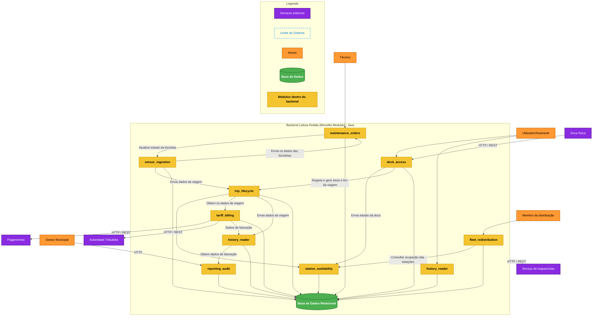

# C4 Nível 3 — Diagrama de Componentes

Este diagrama de componentes detalha os 8 módulos de domínio internos que compõem o **Backend Lisboa Pedala (Monólito Modular)** em Java, as suas interações internas (*Allowed-to-Use*), a persistência na base de dados relacional e a comunicação com os atores e serviços externos, conforme ilustrado na imagem `DiagramaComponent.jpg`.

---

## Descrição dos Componentes e Interações

### 1. Módulos de Domínio Internos
* **`dock_access`**: Ponto de contacto com a doca física. Coordena a trancagem/destrancagem física e delega em `trip_lifecycle` e `station_availability`.
* **`trip_lifecycle`**: Núcleo transacional que orquestra o estado das viagens (`IN_PROGRESS`, `COMPLETED`), notificando `tariff_billing` para faturação.
* **`station_availability`**: Regista a ocupação em tempo real (bicicletas disponíveis e docas livres).
* **`tariff_billing`**: Módulo folha responsável pelo cálculo tarifário (regras de escalões de 15 min, passe gratuito) e interface com a Autoridade Tributária e gateways de pagamento.
* **`sensor_ingestion`**: Recolha de telemetria IoT das bicicletas elétricas (bateria, odómetro, travões).
* **`maintenance_orders`**: Gestão do ciclo de vida das ordens de reparação atribuídas aos técnicos.
* **`fleet_redistribution`**: Algoritmos de sugestão de rotas de rebalanceamento para as carrinhas municipais.
* **`reporting_audit`**: Produção de relatórios consolidados de utilização por freguesia e emissões de CO₂ para a Câmara Municipal.
* **`history_reader`**: Componente de leitura e agregação otimizada para consultas de histórico pelo utilizador e dados consolidados para auditoria.

### 2. Base de Dados Relacional
* Suporte de persistência único no monólito (SQLite em ficheiro), com esquemas de tabelas logicamente segregados por módulo (`schema.sql` em cada componente), garantindo a ausência de acoplamento direto de tabelas.
