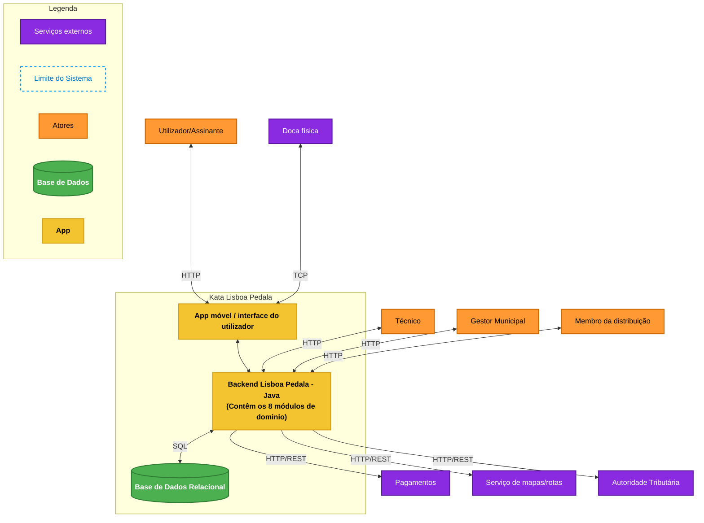

# C4 Nível 2 — Diagrama de Contentores

Este diagrama de contentores ilustra os limites arquiteturais do sistema **Lisboa Pedala**, os contentores de software que o compõem, os protocolos de comunicação e os limites de integração, conforme representado na imagem `DiagramaContainer.jpg`.

---

## Descrição dos Contentores

### 1. Limite do Sistema (Kata Lisboa Pedala)
* **App móvel / interface do utilizador**: Ponto de interação do cliente/assinante para desbloqueio por QR Code, leitura de cartão Navegante e consulta de estações. Comunica via TCP com a doca física em proximidade e via HTTP com o backend.
* **Backend Lisboa Pedala - Java**: Aplicação central estruturada como monólito modular (Java 21), agregando os 8 módulos de domínio de negócio.
* **Base de Dados Relacional**: Persistência partilhada em SQLite/PostgreSQL com esquemas lógicos segregados para cada módulo de domínio.

### 2. Integrações Externas
* **Doca física**: Hardware das estações com protocolo de comunicação TCP.
* **Pagamentos**: Gateway de liquidação financeira (MB WAY / cartões).
* **Serviço de mapas/rotas**: API externa para cálculo de georreferenciação e otimização de rotas de carrinhas.
* **Autoridade Tributária**: Emissão e arquivo fiscal de faturas de viagens (retenção a 10 anos).
