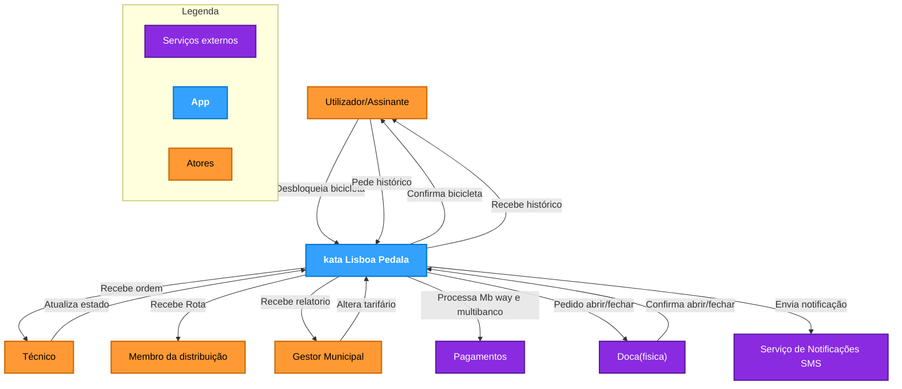

# C4 Nível 1 — Diagrama de Contexto do Sistema

Este diagrama de contexto representa o sistema **Lisboa Pedala**, os seus utilizadores/atores principais e as integrações com serviços e entidades externas, conforme especificado na imagem `Diagrama_Context.jpg`.

---

## Descrição dos Elementos

### 1. Sistema Central
* **kata Lisboa Pedala**: Plataforma central de gestão do serviço de bicicletas partilhadas de Lisboa.

### 2. Atores
* **Utilizador/Assinante**: Interage com o sistema para desbloquear/devolver bicicletas e consultar o histórico de viagens.
* **Técnico**: Recebe ordens de intervenção em bicicletas avariadas e atualiza o estado de manutenção.
* **Membro da distribuição**: Recebe rotas de redistribuição de carrinhas para equilibrar a ocupação das estações.
* **Gestor Municipal**: Consulta relatórios de utilização e emissões de CO₂ e configura regras de tarifário.

### 3. Serviços Externos
* **Pagamentos**: Gateway externo para processamento de pagamentos MB WAY e cartões bancários.
* **Doca (física)**: Hardware IoT eletromecânico das estações com comunicação móvel.
* **Serviço de Notificações SMS**: Gateway para envio de alertas operacionais e recibos.
