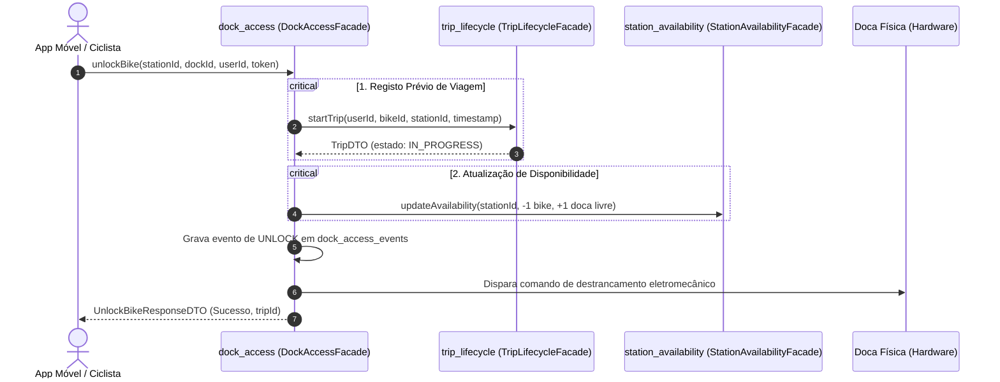
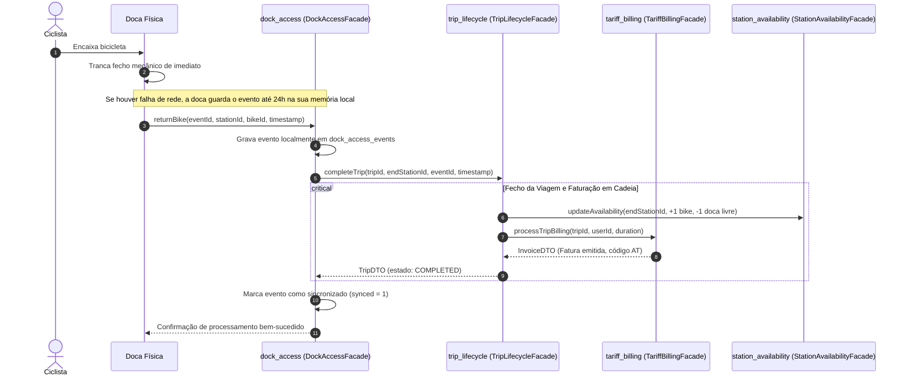

# Módulo `dock_access` — Explicação e Interação entre Componentes

## 1. Visão Geral e Responsabilidade Única

O módulo **`dock_access`** atua como a **ponte de mediação entre o mundo físico das estações (hardware IoT)** e a **lógica transacional central do sistema Lisboa Pedala**.

* **Responsabilidade única:** Validar pedidos de acesso, coordenar o acionamento eletromecânico das docas (destrancar/trancar) e amortecer falhas de comunicação através do armazenamento local de eventos e sincronização com tolerância a desconexão (ADR-004).
* **Posicionamento Arquitetural:** Apresenta um acoplamento equilibrado ($I = 0.5$, com $Ca=1$ e $Ce=1$ ou $Ce=2$), recebendo pedidos dos utilizadores/docas e delegando o estado de negócio no núcleo transacional (`trip_lifecycle`).

---

## 2. Estrutura Interna e Encapsulamento Estrito (ADR-005)

Em conformidade com as regras de governação do Monólito Modular, todo o conteúdo interno do módulo é privado. Outros componentes só conseguem comunicar com o `dock_access` através da sua **fachada pública** e **DTOs públicos**:

```text
pt.ulisboa.lisboapedala.dock_access/
├── DockAccessFacade.java           <-- ÚNICO ponto de entrada público
├── UnlockBikeRequestDTO.java       <-- Contrato público de pedido de desbloqueio
├── UnlockBikeResponseDTO.java      <-- Contrato público de resposta de desbloqueio
├── ReturnBikeRequestDTO.java       <-- Contrato público de devolução
├── ReturnBikeResponseDTO.java      <-- Contrato público de resposta à devolução
├── DockEventDTO.java               <-- Contrato público representativo de eventos físicos
├── business/                       <-- INTERNO (inacessível fora do módulo)
│   └── DockAccessService.java      <-- Orquestração do desbloqueio, trancamento e buffer offline
└── persistence/                    <-- INTERNO (inacessível fora do módulo)
    ├── DockEventRepository.java    <-- Acesso à tabela privada
    └── schema.sql                  <-- Tabela privada dock_access_events
```

---

## 3. Matriz de Interações (*Allowed-to-Use*)

O isolamento e as regras de dependência deste módulo são verificadas automaticamente por testes de arquitetura com **ArchUnit** ([ModularMonolithArchitectureTest.java](file:///c:/FCUL/1%20semestre/DS/TP1_DS/tests/architecture/ModularMonolithArchitectureTest.java)):

| Relação | Módulo / Componente | Natureza da Comunicação | Finalidade |
| :--- | :--- | :--- | :--- |
| **Quem invoca o `dock_access`?** | App Móvel / Totem da Estação | Entrada (Controlador / REST / CLI) | Solicitar desbloqueio por QR Code ou cartão Navegante. |
| | Doca Física (Hardware IoT) | Entrada (Comunicação de rede móvel) | Envio de sinal mecânico de trancamento no momento da devolução. |
| **Quem o `dock_access` PODE invocar?** | `trip_lifecycle` | Invocação síncrona via `TripLifecycleFacade` | Iniciar formalmente a viagem (`startTrip`) e concluir a viagem com cálculo de duração (`completeTrip`). |
| | `station_availability` | Invocação síncrona via `StationAvailabilityFacade` | Atualizar os contadores de docas livres e bicicletas disponíveis na estação. |
| **Quem o `dock_access` NÃO PODE invocar?** | `tariff_billing` | **Proibido** | O `dock_access` não calcula tarifas nem faz cobranças. Isso é responsabilidade exclusiva de `trip_lifecycle` $\rightarrow$ `tariff_billing`. |
| | `sensor_ingestion` | **Proibido** | Telemetria e anomalias são tratadas em domínios próprios. |
| | Base de dados de outro módulo | **Proibido** | Não faz consultas SQL a tabelas de outros módulos nem partilha entidades JPA/JDBC. |

---

## 4. Fluxos Operacionais Detalhados

### 4.1. Fluxo de Desbloqueio (Online Obrigatório)
O ciclista encosta o cartão Navegante ou faz leitura de código QR na estação. O sistema exige conectividade com o backend para validação antifraude e saldo:



> **Garantia de Disponibilidade e Integridade:** A viagem é criada no estado `IN_PROGRESS` **antes** de o comando de abertura ser enviado à doca física. Se a criação da viagem falhar, a doca física não destranca.

---

### 4.2. Fluxo de Devolução e Resiliência Offline (ADR-004)
Ao devolver a bicicleta, o utilizador encaixa-a na doca. O fecho físico tranca mecanicamente de imediato. Mesmo que a rede móvel da estação esteja em baixo (ex: zonas de sombra de Lisboa), a operação é concluída com sucesso:



---

## 5. Idempotência e Tratamento de Reenvios

Em caso de falha transitória de comunicação, o mesmo evento de devolução pode ser enviado repetidamente pela doca física (ex: retries automáticos):

1. O `dock_access` recebe o `eventId` / `returnEventId`.
2. O `trip_lifecycle` valida se a viagem ou o `returnEventId` já se encontram no estado `COMPLETED`.
3. Se já estiver processado:
   * **Não cria uma nova viagem.**
   * **Não duplica a cobrança no `tariff_billing`** (a fatura já existente é apenas devolvida).
   * **Não incrementa novamente os contadores** no `station_availability`.
   * Responde com sucesso à doca física para confirmar que o evento foi recebido, limpando o buffer da doca.

---

## 6. Persistência Isolada (`schema.sql`)

O `dock_access` é dono exclusivo da tabela `dock_access_events`, localizada em:
- [schema.sql](file:///c:/FCUL/1%20semestre/DS/TP1_DS/src/main/resources/pt/ulisboa/lisboapedala/dock_access/persistence/schema.sql)

```sql
CREATE TABLE IF NOT EXISTS dock_access_events (
    event_id TEXT PRIMARY KEY,
    station_id TEXT NOT NULL,
    dock_id TEXT NOT NULL,
    bike_id TEXT NOT NULL,
    user_id TEXT,
    event_type TEXT NOT NULL,      -- 'UNLOCK' ou 'RETURN'
    occurred_at TEXT NOT NULL,
    synced INTEGER NOT NULL DEFAULT 0
);
```

Nenhum outro módulo tem acesso de leitura ou escrita a esta tabela.
